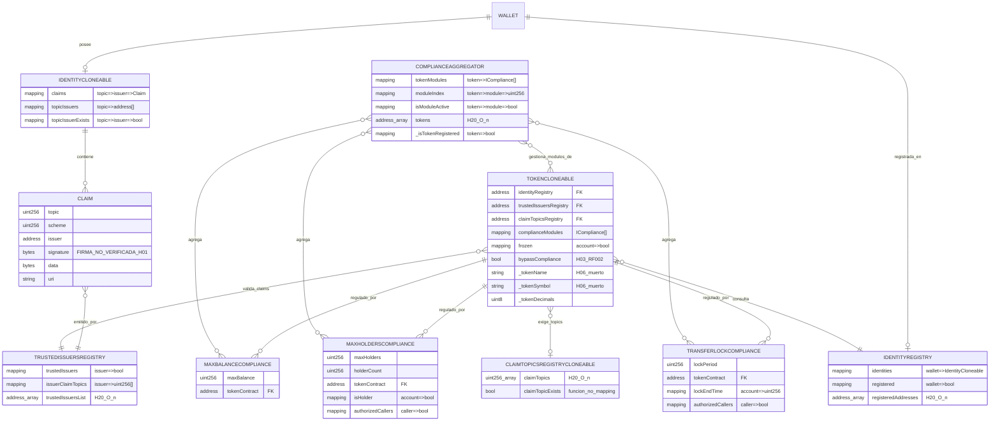
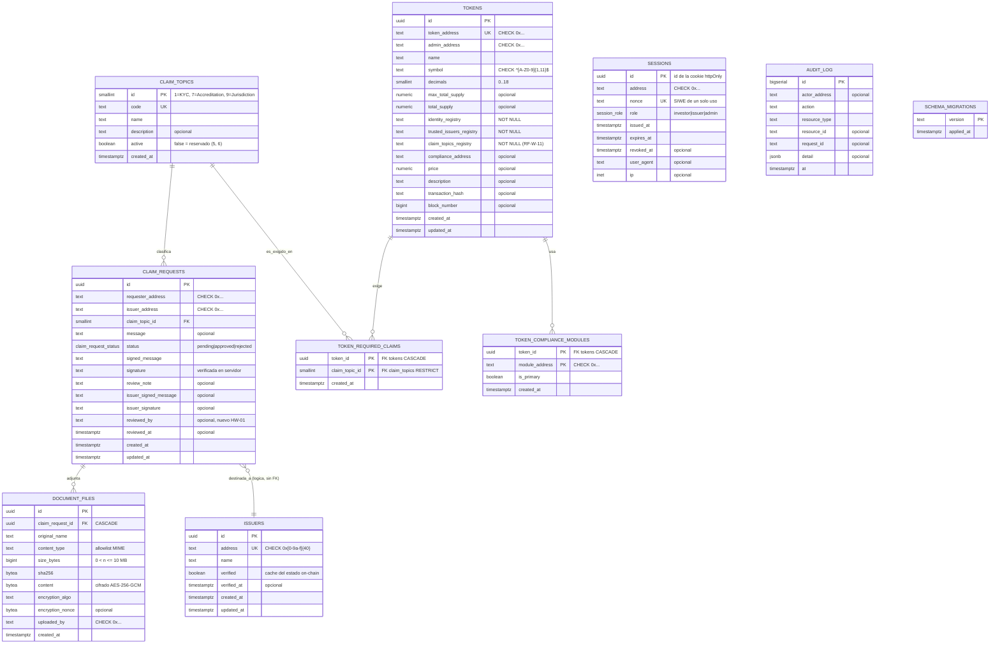
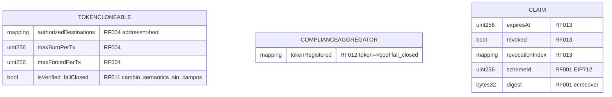

# 📐 Diagrama Entidad-Relación — RWA

> **🔗 Artefacto de datos compartido — copia espejo sincronizada (2026-10-14).** Existe en las dos líneas
> de desarrollo: **canónico** `rwa-sc/RepoTecnico/diagrama_er.md` · **espejo** `rwa-web/RepoTecnico/diagrama_er.md`.
> Deben ser **idénticos byte a byte**: edita solo el canónico y ejecuta `rwa-web/RepoTecnico/check_sincronizacion_datos.sh --sync`
> (regla de sincronización en `rwa-web/RepoTecnico/ARTEFACTOS_DATOS_SINCRONIZADOS.md`).
>
> **Versión: v1.2 · 2026-10-14.** Cubre el modelo de datos del proyecto: on-chain (contratos de
> `rwa-sc/sc/src/`) y off-chain (**PostgreSQL**, esquema `rwa`).
> **Sincronizado con `diccionario_datos.md` v1.2** (mismo nombre para cada entidad, campo y topic) y con
> `base_datos.sql` v1.0.
>
> **Changelog v1.2 (2026-10-14):** **Q6 resuelta (D-095):** el modelo off-chain pasa de MongoDB a
> **PostgreSQL**; §2 se reescribe con entidades del esquema `rwa` (nuevas `CLAIM_TOPICS`, `SESSIONS`,
> `AUDIT_LOG`; `DOCUMENT_FILES` con contenido cifrado; tablas puente `TOKEN_REQUIRED_CLAIMS` y
> `TOKEN_COMPLIANCE_MODULES`). Red on-chain canónica del frontend: **Anvil de GCP** (D-096). §3 pasa a
> referencia histórica (los cambios que figuraban como planificados **se implementaron** en la Fase 3).
>
> **Changelog v1.1:** regenerado contra el storage real (H-14); se eliminan `holders[]`, `holderIndex[]`,
> `firstReceiveTime`, `issuerTopics` y el campo `token` de los módulos/registro de topics; se añade el
> bloque **§3 PLANIFICADO** (RF-001, RF-004, RF-011, RF-012, RF-013); se corrige el modelo off-chain
> (`requesterAddress`, `tokenAddress`, `requiredClaims`, colección `issuers`, metadata GridFS).
> Trazabilidad: `INFORME_OPTIMIZACION_V1.md` (H-13, H-14, H-08, H-11, H-20).

## 1. Modelo on-chain — EXISTENTE hoy

> **H-14:** en esta versión **no** aparecen `holders[]`, `holderIndex[]`, `firstReceiveTime` ni
> `issuerTopics`. El estado por cuenta de holders es `isHolder` + `holderCount`; el lock es `lockEndTime`;
> la autorización por topic es `issuerClaimTopics`; el token en los módulos es `tokenContract`.

## 2. Modelo off-chain (**PostgreSQL**, esquema `rwa`) — v1.2

> **Q6 RESUELTA (D-095):** la BD off-chain es **PostgreSQL**, no MongoDB. Entidades, campos y claves son
> **idénticos** a `base_datos.sql` v1.0 y a `diccionario_datos.md` §2 (sincronizados en el mismo turno).

> **Relaciones:** `CLAIM_REQUESTS → ISSUERS` es **lógica** (no hay FK: la tabla `issuers` es solo el nombre
> visible y la integridad del emisor vive on-chain en `TrustedIssuersRegistry`). `DOCUMENT_FILES` pertenece a
> la solicitud (`ON DELETE CASCADE`) y es la unidad de autorización de acceso (RF-W-06). Las tablas puente
> `TOKEN_REQUIRED_CLAIMS` y `TOKEN_COMPLIANCE_MODULES` normalizan los antiguos arrays
> `requiredClaims`/`complianceModules`. `SESSIONS` y `AUDIT_LOG` no tienen FK (identifican wallets por
> dirección, no por usuario). Vista de apoyo: `rwa.v_claim_request_summary`.

## 3. Cambios on-chain implementados en Fase 3 (referencia histórica)

> **Nota v1.2:** este bloque figuraba como *PLANIFICADO*. La Fase 3 lo **implementó y verificó**
> (394/394 tests, cobertura `src/` 97,05 %): RF-001/RF-002/RF-004/RF-011/RF-012/RF-013. Se conserva como
> referencia; el estado real está en `estado_proyecto.md`. **No existe hoy** como bloque separado del modelo
> on-chain real de §1 — no debe confundirse con §1/§2. La etapa actual (D-088) **no modifica** el storage
> on-chain.

| Requisito | Entidad afectada | Cambio planificado |
|---|---|---|
| RF-004 | `TokenCloneable` | `authorizedDestinations[address]`, `maxBurnPerTx`, `maxForcedPerTx` |
| RF-011 | `TokenCloneable` | `isVerified` fail-closed (cambio de comportamiento, sin campos) |
| RF-012 | `ComplianceAggregator` | estado explícito `tokenRegistered[token]` (hoy `_isTokenRegistered` implícito) |
| RF-013 | `IdentityCloneable` / `Claim` | `expiresAt`, `revoked`, índice de revocación |
| RF-001 | `IdentityCloneable` / `Claim` | `schemeId` + digest EIP-712 y `ecrecover` |

## 4. Relaciones clave a preservar

1. **wallet → identity → claims → trusted issuer**: cadena de verificación de `isVerified()` del token.
2. **token → claimTopicsRegistry (1:1 por token)**: requisitos dinámicos por emisión.
3. **compliance module: N agregados por token a través de `ComplianceAggregator`** (el token puede tener
   además módulos directos en `complianceModules`).
4. **claim_request off-chain → claim on-chain**: la aprobación del issuer dispara `addClaim` on-chain
   (flujo actual **sin verificación de firma** — H-01/RF-001).

## 5. Catálogo de claim topics (idéntico al diccionario §3)

- **Oficial:** `1 = KYC`, `7 = Accreditation`, `9 = Jurisdiction` (`rwa-web/README.md:325-327`).
- **Reservado/backlog:** `5 = Environmental`, `6 = Sanctions` (**no implementados**, H-10/R-2).
- **Deprecados:** catálogos `1/2/3/4` (`ARQUITECTURA_FINAL.md:65`), `1/2/3/9/10`
  (`REFERENCIA_TECNICA.md:823-833`) y `5/6/7`; y las fixtures de test `1/2`, `1/2/3` y `2=Accreditation`.
