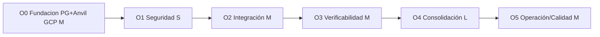

# Plan de Desarrollo Vertical — Optimización del Frontend (`@web`)

> **Línea de desarrollo:** `@web` — este documento vive en `rwa-web/RepoTecnico/` (reorganización de las dos líneas, 2026-10-14).
> Los artefactos de datos compartidos (`base_datos.sql`, `diccionario_datos.md`, `diagrama_er.md`) existen en las dos líneas
> (canónico en `rwa-sc/RepoTecnico/` + espejo en `rwa-web/RepoTecnico/`, sincronizados byte a byte). La documentación de la
> línea `@sc` permanece en `rwa-sc/RepoTecnico/`.
>
> **Proyecto:** RWA · **Área:** `rwa-web/` · **Versión:** v1.1 · **Fecha:** 2026-10-14
> **Requisitos:** `requerimientos_web.md` v1.1 · **Hallazgos:** `INFORME_OPTIMIZACION_WEB_V1.md`
> **Decisiones:** D-088 (solo web) · D-089 (hardening + monorepo) · D-090 (orden de ciclos) · D-091 (Anvil 31337) · D-092 (SIWE) · D-093 (documentos cifrados) · D-094 (repo `rwa-web`) · **D-095 (BD off-chain = PostgreSQL)** · **D-096 (red canónica = Anvil de GCP)**
>
> **Changelog v1.1 (2026-10-14):** decisión del usuario — BD off-chain **PostgreSQL** y red canónica
> **Anvil de GCP** (chain 31337). Se añade el ciclo **O0 (Fundación: datos + red)**, pendiente de confirmar
> porque **matiza el orden aprobado en D-090**; O1, O2 y O5 se ajustan en consecuencia. Esquema de datos:
> `base_datos.sql` v1.0 (sincronizado con `diccionario_datos.md` v1.2 y `diagrama_er.md` v1.2).

---

## 1. Principios de ejecución

1. **Un ciclo = una entrega operativa.** Al cerrar cada ciclo, la aplicación funciona y las pruebas del ciclo pasan.
2. **Commit por ciclo** en `rwa-web`, con mensaje `O<n>: <objetivo>` y la evidencia de verificación en el cuerpo. **Nunca `push` sin orden explícita del usuario (`/push`).**
3. **Nada se declara hecho sin comando reproducible.** Cada ciclo define su *gate* (§2 de cada ciclo) y el informe de cierre cita la salida real.
4. **No se toca `rwa-sc`** salvo lectura de `sc/abis/` y `sc/deployments/` (D-088).
5. **Los tres artefactos de datos PostgreSQL no se modifican**; si un ciclo cambia el modelo MongoDB, se actualiza `requerimientos_web.md` §5 en el mismo turno.

---

## 2. Ciclos

### O0 — Fundación: PostgreSQL + red Anvil de GCP · esfuerzo M · sin dependencias · **(D-100: aprobado como primer ciclo)**

**Objetivo:** que el frontend arranque sobre la arquitectura decidida (D-095/D-096/D-097/D-098/D-099) antes de endurecer nada.

| # | Tarea | Requisito |
|---|---|---|
| **O0.1 ✅ HECHO (2026-10-14)** | `base_datos.sql` v1.0 **aplicado** en Cloud SQL `truekeate-db-dev` (PG 15.18, región `southamerica-east1-a`, IP `34.39.180.101`, usuario `app`): 10 tablas + 1 vista + 29 índices + catálogo de 5 topics; `schema_migrations` = `1.0`; **idempotente** (2ª ejecución sin errores). Evidencia: `pruebas/verificacion_gcp_o0.md` | RT-W-07, D-097 |
| O0.2 | Capa de datos en `packages/shared` (o módulo equivalente): pool único, consultas parametrizadas y repositorios (`claim_requests`, `document_files`, `tokens`, `issuers`, `sessions`, `audit_log`) | RT-W-07 |
| O0.3 | Sustituir todo acceso MongoDB (`lib/mongodb.ts` ×3, `mongodb` en 3 `package.json`) por la capa PostgreSQL | RF-W-14, RT-W-07 |
| O0.4 | **Arranque limpio (D-099):** esquema vacío + catálogo de topics sembrado. **Sin ETL**; el Anexo A de `base_datos.sql` queda documentado como migración opcional | D-099 |
| O0.5 | Configuración única de red apuntando al **Anvil de GCP** (`MCC_ANVIL_RPC_URL`, chain 31337) con validación al arranque | RF-W-08, D-096 |
| O0.6 ⏳ (parcial) | **Hecho:** `rwa-web/scripts/gcp-env.sh` (exporta y **verifica** ambos servicios) y `rwa-web/.env.example`. **Falta:** consumirlos desde la app y validar que no hay secretos en el árbol | RT-W-08 |
| O0.7 | Prueba de humo: `SELECT 1` + lectura de `claim_topics` + `chainId` on-chain = 31337 (**componentes ya verificados**; falta integrarlo en la app) | RT-W-07 |

**Entregable:** aplicación leyendo y escribiendo en PostgreSQL y contra el Anvil de GCP.
**Gate:** esquema aplicado (`\dt rwa.*` con 10 tablas + 1 vista), 5 topics sembrados, `cast chain-id` = 31337 y smoke test en verde.
**Riesgo:** Cloud SQL vía Auth Proxy no disponible en el entorno → plan B: PostgreSQL local en `docker-compose` con el mismo esquema (el SQL es idéntico).

---

### O1 — Contención de seguridad · esfuerzo S · depende de O0

**Objetivo:** cerrar la fuga de datos y la mutación anónima de estado antes de tocar nada más.

| # | Tarea | Requisito |
|---|---|---|
| O1.1 | Retirar `/api/test-gridfs` y `/api/test-db` del árbol (o condicionarlos a `ALLOW_DEBUG_ENDPOINTS=1` en local) | RF-W-07 |
| O1.2 | Verificar firma y autorización de issuer en `POST /api/update-request`; derivar emisor de la firma; idempotencia; `reviewedBy`/`reviewedAt` | RF-W-03 |
| O1.3 | Autenticar y autorizar `GET/POST /api/claim-requests`: el inversor solo ve lo suyo; el issuer solo lo dirigido a él | RF-W-02 |
| O1.4 | Autorizar `GET /api/download/[fileId]` por titular/issuer del claim; leer de `rwa.document_files` descifrando en servidor; `attachment` + `nosniff`; validación por magic bytes; registrar en `audit_log` | RF-W-05, RF-W-06 |
| O1.5 | Proteger el *upsert* de `issuers` (nombre) y las escrituras de `tokens` (`price`, `claims`, `modules`, `compliance`) | RF-W-02, RF-W-12 |
| O1.6 | Errores tipados: `503` ante dependencia caída; sin `error.message` de librería al cliente | RF-W-13 |
| O1.7 | Tests de rechazo: `curl` anónimo contra cada mutación devuelve `401/403` | RNF-W-01 |

**Entregable:** ninguna ruta muta estado ni entrega PII sin sesión autorizada.
**Gate:** suite de tests de autorización en verde (una prueba negativa por ruta); `GET /api/test-gridfs` → `404`.
**Riesgo:** romper el flujo de las apps actuales al exigir sesión → se implementa con mensaje de error claro y se documenta la transición en el mismo ciclo.

---

### O2 — Sincronización con los contratos · esfuerzo M · depende de O1

**Objetivo:** que el flujo identidad → claim → aprobación → `isVerified` funcione contra los contratos actuales en el **Anvil de GCP (chain 31337, D-096)**.

| # | Tarea | Requisito |
|---|---|---|
| O2.1 | Módulo único de red (`chainId`+RPC+direcciones) desde `sc/deployments/*.json`, apuntando al Anvil de GCP (`MCC_ANVIL_RPC_URL`), con validación al arranque | RF-W-08, D-091, D-096 |
| O2.2 | Regenerar ABIs desde `sc/abis/` y eliminar las copias inline (3 en `web-identity`) | RF-W-09 |
| O2.3 | Implementar `addClaim` con 7 argumentos + firma EIP-712 (incluido `uriHash`, D-083) en el flujo de la identidad | RF-W-10 |
| O2.4 | Bloquear creación de token si falta `claimTopicsRegistry` y configurar compliance en el mismo flujo | RF-W-11 |
| O2.5 | Verificar en UI que el `chainId` de la wallet coincide con el canónico | RF-W-08 |
| O2.6 | Gate `check-abi-drift` y `check-network-literals` (sin literales `0x…40`, `localhost:`, `http://`) | RF-W-09, RNF-W-07 |
| O2.7 | Prueba de integración E2E del flujo completo contra Anvil | RNF-W-08 |

**Entregable:** flujo completo operativo y documentado en `RepoTecnico/pruebas/` con evidencia.
**Gate:** E2E en verde + gates de deriva y literales en verde.

---

### O3 — Verificabilidad (repo + CI + versiones) · esfuerzo M · depende de O2

**Objetivo:** poder verificar cualquier cambio futuro.

| # | Tarea | Requisito |
|---|---|---|
| O3.1 | Crear repositorio `rwa-web`, historia completa, `.gitignore` correcto (`env.local` → `.env.local`), `.env.example` por app | RF-W-15, D-094 |
| O3.2 | Fijar `.env` fuera del árbol y verificar con `git check-ignore` | RNF-W-07 |
| O3.3 | Unificar `next`/`react` a una versión única por workspace | RNF-W-03 |
| O3.4 | Retirar `typescript.ignoreBuildErrors` y saldar los errores de tipo app por app | RNF-W-03 |
| O3.5 | CI: `lint`, `tsc --noEmit`, `build`, `test`, `check-network-literals`, `check-abi-drift` | RF-W-15 |
| O3.6 | Tests: Vitest en rutas críticas + 1 E2E Playwright del flujo claim→aprobación | RNF-W-08 |
| O3.7 | Logger estructurado y eliminación de `console.log` en rutas/componentes | RF-W-16, RT-W-10 |

**Entregable:** `rwa-web` versionado con CI en verde y cobertura ≥ 70 % en lo crítico.
**Gate:** pipeline completo en verde sobre el repositorio (local y remoto cuando el usuario autorice `/push`).

---

### O4 — Consolidación en monorepo · esfuerzo L · depende de O3

**Objetivo:** 3 apps mantenibles sobre una base compartida.

| # | Tarea | Requisito |
|---|---|---|
| O4.1 | Estructura pnpm: `apps/{identity,issuer,token}`, `packages/{shared,ui,config}` | RF-W-14, RT-W-05 |
| O4.2 | `packages/shared`: red, ABIs generados, tipos, cliente MongoDB, cliente de API tipado, esquemas `zod`, logger | RF-W-14, RT-W-03 |
| O4.3 | Eliminar duplicados: `mongodb.ts` ×3, `TrustedIssuersRegistry.ts` ×2, `RequestDetailModal` ×2, landings duplicadas | RNF-W-03 |
| O4.4 | Decidir y ejecutar el destino de `web-registry-trusted2` (base del panel de emisor con `viem`, o retirada) | RF-W-18 |
| O4.5 | Decidir el destino de `web-rwa` (portal con enlaces configurables o absorción) | RF-W-18 |
| O4.6 | Unificar stack web3 en `wagmi`+`viem` y eliminar los 96 usos de `window.ethereum` | RT-W-02 |
| O4.7 | Datos de cliente con TanStack Query | RT-W-04 |

**Entregable:** monorepo con 3 apps construyendo y test pasando; 0 ficheros muertos.
**Gate:** `pnpm -r build && pnpm -r test` en verde; conteo de duplicados = 0.

---

### O5 — Operación y calidad · esfuerzo M · depende de O4

**Objetivo:** entorno reproducible y calidad medible.

| # | Tarea | Requisito |
|---|---|---|
| O5.1 | `docker-compose`: 3 apps + MongoDB + nodo Anvil, con healthchecks | RF-W-17, RT-W-09 |
| O5.2 | Imágenes multi-stage con `standalone`, `PORT` configurable y healthcheck HTTP | RF-W-17 |
| O5.3 | Retirar `docker-build/` parciales y la ruta absoluta de desarrollador | RF-W-17 |
| O5.4 | Cifrado AES-256-GCM de documentos KYC en `rwa.document_files` con `KYC_ENCRYPTION_KEY` en Secret Manager; `audit_log` en cada acceso | RNF-W-02, D-093, D-095, RT-W-08 |
| O5.5 | Índices PostgreSQL de `base_datos.sql` §6; limpieza programada de `sessions` caducadas; política de retención de `audit_log`; backup/restauración del esquema `rwa` | RNF-W-02, RT-W-07 |
| O5.6 | Accesibilidad: `axe` sin violaciones críticas; notificaciones y estados unificados | RNF-W-05 |
| O5.7 | Presupuesto de rendimiento medido en build de producción | RNF-W-06 |
| O5.8 | Documentación: README raíz con el mapa real de apps y puertos | RF-W-18 |

**Entregable:** entorno levantable con una orden, RNF web medidos y documentados.
**Gate:** `docker compose up` sano + informes de `axe`, Lighthouse y cobertura adjuntos.

---

## 3. Orden, dependencias y calendario estimado

| Ciclo | Esfuerzo | Estimación | Salida verificable |
|---|---|---|---|
| O0 | M | 2–5 días | App sobre PostgreSQL + Anvil de GCP |
| O1 | S | ≤ 1 semana | 0 rutas sin autorización |
| O2 | M | 2–5 días | E2E claim→`isVerified` en verde |
| O3 | M | 2–5 días | CI en verde sobre `rwa-web` |
| O4 | L | > 1 semana | 3 apps sobre monorepo |
| O5 | M | 2–5 días | RNF medidos y entorno reproducible |

---

## 4. Estrategia de ramas y commits

- Repositorio: **`rwa-web`** (nuevo, D-094), rama de trabajo propuesta **`rwa-web-DSH`** (coherente con `rwa-sc-DSH-GCP`).
- Un commit por ciclo: `O<n>: <objetivo> (<hallazgos>)\n\nGate: <comando + resultado>\nReq: RF-W-…, RNF-W-…`
- **Sin `push`** hasta que el usuario lo ordene con `/push`.
- Secretos: `.env.local` ignorado y `.env.example` versionado; gate `check_secrets` reutilizado del área de contratos.

---

## 5. Definición de terminado (DoD) de la etapa

1. Los 6 ciclos (**O0–O5**) cerrados con su *gate* en verde y evidencia adjunta en `RepoTecnico/pruebas/`.
2. Criterios **B-1…B-6** y **C-1…C-5** del informe WEB V1 cumplidos y verificados por un revisor independiente.
3. `estado_proyecto.md` actualizado con métricas reales finales (rutas con auth, cobertura, versiones, tamaño de bundle).
4. Informe de cierre de la etapa en `RepoTecnico/informe_optimizacion_web_cierre.md` con antes/después medido.

---

## 6. Registro de avance

| Ciclo | Estado | Fecha | Evidencia |
|---|---|---|---|
| O0 | 🟡 **En curso — O0.1 completado** (esquema aplicado y verificado en Cloud SQL) | 2026-10-14 | `pruebas/verificacion_gcp_o0.md` |
| O1 | ⏳ Pendiente de aprobación del plan | — | — |
| O2 | ⏳ No iniciado | — | — |
| O3 | ⏳ No iniciado | — | — |
| O4 | ⏳ No iniciado | — | — |
| O5 | ⏳ No iniciado | — | — |

---

*Fin del documento — plan_desarrollo_web.md v1.0*
