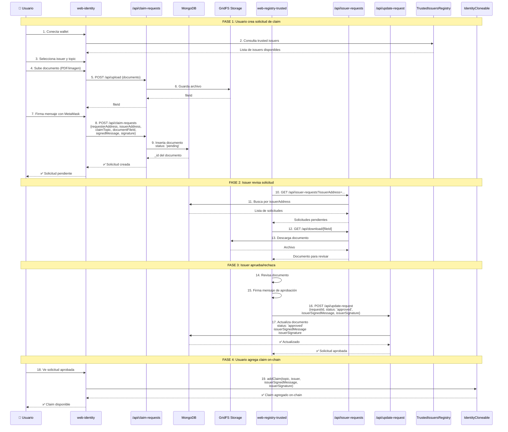
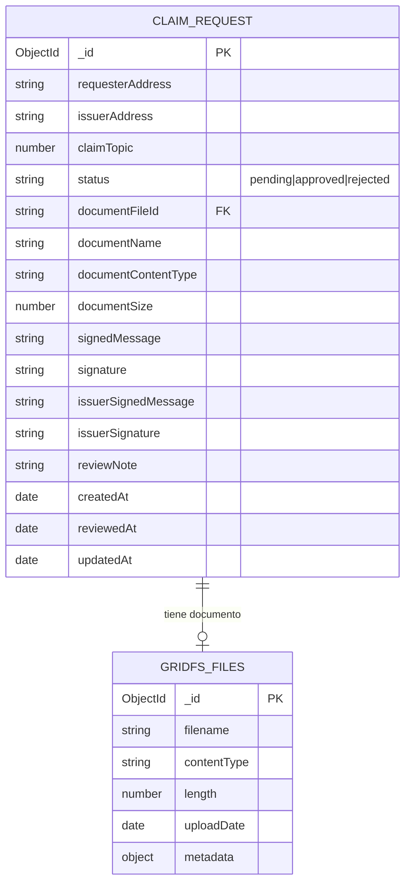

# 📊 Diagramas de Arquitectura RWA Web

## 🔗 Relación entre web-identity y web-registry-trusted

Este diagrama muestra la interacción entre las dos aplicaciones web principales del sistema RWA:

- **web-identity** (Puerto 4001): Aplicación para usuarios/inversores que gestionan sus identidades y solicitan claims
- **web-registry-trusted** (Puerto 4002): Panel para emisores confiables que revisan y aprueban solicitudes de claims

```mermaid
graph TB
    subgraph Users["👥 USUARIOS"]
        Investor[👤 Inversor/Usuario<br/>MetaMask Wallet]
        Issuer[🏛️ Trusted Issuer<br/>MetaMask Wallet]
    end

    subgraph WebIdentity["🌐 web-identity (Puerto 4001)"]
        subgraph Pages["📄 Páginas"]
            IdentityPage[Página Principal<br/>- Crear identidad<br/>- Ver claims<br/>- Solicitar claims]
        end
        
        subgraph Components["🧩 Componentes"]
            ClaimForm[ClaimRequestForm<br/>- Seleccionar issuer<br/>- Seleccionar topic<br/>- Subir documento]
            RequestsList[ClaimRequestsList<br/>- Ver mis solicitudes<br/>- Estado: pending/approved/rejected]
        end
        
        subgraph APIs["🔌 API Routes"]
            API_CreateRequest[POST /api/claim-requests<br/>Crear solicitud]
            API_GetRequests[GET /api/claim-requests<br/>Listar solicitudes]
            API_Upload[POST /api/upload<br/>Subir documento]
            API_Download[GET /api/download/[fileId]<br/>Descargar documento]
        end
    end

    subgraph WebRegistry["🎫 web-registry-trusted (Puerto 4002)"]
        subgraph Pages2["📄 Páginas"]
            RegistryPage[Página Principal<br/>- Ver solicitudes<br/>- Aprobar/Rechazar<br/>- Gestionar issuers]
        end
        
        subgraph Components2["🧩 Componentes"]
            IssuerList[IssuerRequestsList<br/>- Filtrar por estado<br/>- Ver detalles]
            RequestModal[RequestDetailModal<br/>- Ver documento<br/>- Agregar nota<br/>- Firmar y aprobar]
        end
        
        subgraph APIs2["🔌 API Routes"]
            API_GetIssuerRequests[GET /api/issuer-requests<br/>Obtener solicitudes del issuer]
            API_UpdateRequest[POST /api/update-request<br/>Aprobar/Rechazar solicitud]
            API_Download2[GET /api/download/[fileId]<br/>Descargar documento]
        end
    end

    subgraph Database["💾 MongoDB"]
        Collection[claim_requests Collection<br/>- requesterAddress<br/>- issuerAddress<br/>- claimTopic<br/>- status: pending/approved/rejected<br/>- documentFileId<br/>- signedMessage<br/>- signature<br/>- issuerSignedMessage<br/>- issuerSignature]
        GridFS[(GridFS<br/>Almacenamiento de<br/>documentos PDF/Imágenes)]
    end

    subgraph Blockchain["⛓️ Blockchain (Anvil)"]
        TIR[TrustedIssuersRegistry<br/>- getTrustedIssuers<br/>- isTrustedIssuer<br/>- getTrustedIssuersForTopic]
        IR[IdentityRegistry<br/>- registerIdentity<br/>- isRegistered<br/>- getIdentity]
        ICF[IdentityCloneFactory<br/>- createIdentity]
        IC[IdentityCloneable<br/>- addClaim<br/>- hasClaim]
    end

    %% Usuario interactúa con web-identity
    Investor -->|1. Conecta wallet| IdentityPage
    Investor -->|2. Crea solicitud| ClaimForm
    ClaimForm -->|3. POST /api/claim-requests| API_CreateRequest
    ClaimForm -->|4. POST /api/upload| API_Upload
    API_Upload -->|5. Guarda archivo| GridFS
    API_CreateRequest -->|6. Inserta documento| Collection
    
    %% web-identity consulta blockchain
    ClaimForm -.->|Consulta issuers| TIR
    IdentityPage -.->|Verifica registro| IR
    IdentityPage -.->|Crea identidad| ICF
    
    %% Usuario consulta sus solicitudes
    Investor -->|7. Ver solicitudes| RequestsList
    RequestsList -->|8. GET /api/claim-requests| API_GetRequests
    API_GetRequests -->|9. Consulta| Collection
    
    %% Issuer interactúa con web-registry-trusted
    Issuer -->|10. Conecta wallet| RegistryPage
    RegistryPage -->|11. Ver solicitudes| IssuerList
    IssuerList -->|12. GET /api/issuer-requests| API_GetIssuerRequests
    API_GetIssuerRequests -->|13. Consulta por issuerAddress| Collection
    
    %% Issuer revisa y aprueba
    IssuerList -->|14. Ver detalles| RequestModal
    RequestModal -->|15. GET /api/download/[fileId]| API_Download2
    API_Download2 -->|16. Descarga| GridFS
    RequestModal -->|17. POST /api/update-request| API_UpdateRequest
    API_UpdateRequest -->|18. Actualiza status| Collection
    
    %% web-registry-trusted consulta blockchain
    RegistryPage -.->|Verifica issuer| TIR
    RequestModal -.->|Firma claim| IC
    
    %% Flujo de datos compartidos
    Collection -.->|Misma colección| API_GetRequests
    Collection -.->|Misma colección| API_GetIssuerRequests
    GridFS -.->|Mismo almacenamiento| API_Download
    GridFS -.->|Mismo almacenamiento| API_Download2

    %% Styling
    classDef user fill:#e3f2fd,stroke:#1976d2,stroke-width:2px
    classDef webapp fill:#f3e5f5,stroke:#7b1fa2,stroke-width:2px
    classDef api fill:#fff3e0,stroke:#f57c00,stroke-width:2px
    classDef db fill:#e8f5e9,stroke:#388e3c,stroke-width:2px
    classDef blockchain fill:#fce4ec,stroke:#c2185b,stroke-width:2px

    class Investor,Issuer user
    class IdentityPage,RegistryPage,ClaimForm,RequestsList,IssuerList,RequestModal webapp
    class API_CreateRequest,API_GetRequests,API_Upload,API_Download,API_GetIssuerRequests,API_UpdateRequest,API_Download2 api
    class Collection,GridFS db
    class TIR,IR,ICF,IC blockchain
```

### 🔄 Flujo Completo de Solicitud de Claim



### 📋 Estructura de Datos Compartidos



### 🔐 Endpoints API Compartidos

| Endpoint | Método | Aplicación | Descripción |
|----------|--------|------------|-------------|
| `/api/claim-requests` | POST | web-identity | Crear nueva solicitud de claim |
| `/api/claim-requests` | GET | web-identity | Listar solicitudes del usuario |
| `/api/issuer-requests` | GET | web-registry-trusted | Listar solicitudes para un issuer |
| `/api/update-request` | POST | web-registry-trusted | Aprobar/rechazar solicitud |
| `/api/upload` | POST | web-identity | Subir documento a GridFS |
| `/api/download/[fileId]` | GET | Ambas | Descargar documento de GridFS |

### 🎯 Puntos Clave de Integración

1. **Base de Datos Compartida**: Ambas aplicaciones usan la misma instancia de MongoDB y la misma colección `claim_requests`

2. **Almacenamiento de Documentos**: GridFS es compartido, permitiendo que web-identity suba documentos y web-registry-trusted los descargue

3. **Smart Contracts**: Ambas consultan `TrustedIssuersRegistry` para validar issuers, pero web-identity también interactúa con `IdentityRegistry` e `IdentityCloneFactory`

4. **Flujo Asíncrono**: 
   - Usuario crea solicitud → Estado: `pending`
   - Issuer revisa y aprueba → Estado: `approved` + firma
   - Usuario agrega claim on-chain usando la firma del issuer

5. **Seguridad**: 
   - Firma de mensajes con MetaMask en ambos lados
   - Validación de issuers contra TrustedIssuersRegistry
   - Verificación de firmas antes de agregar claims on-chain
